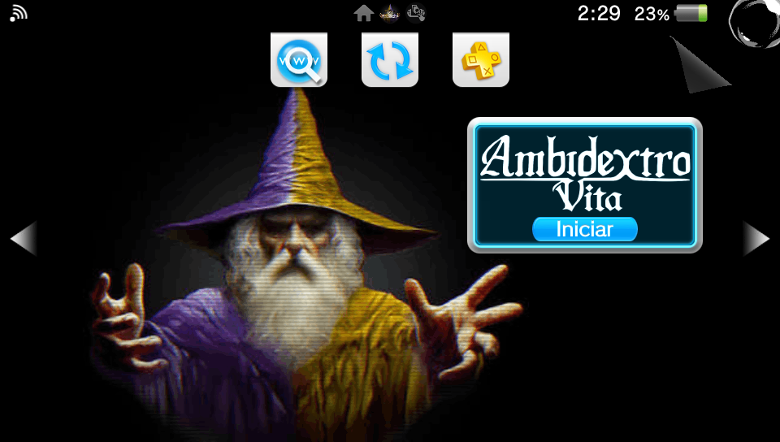
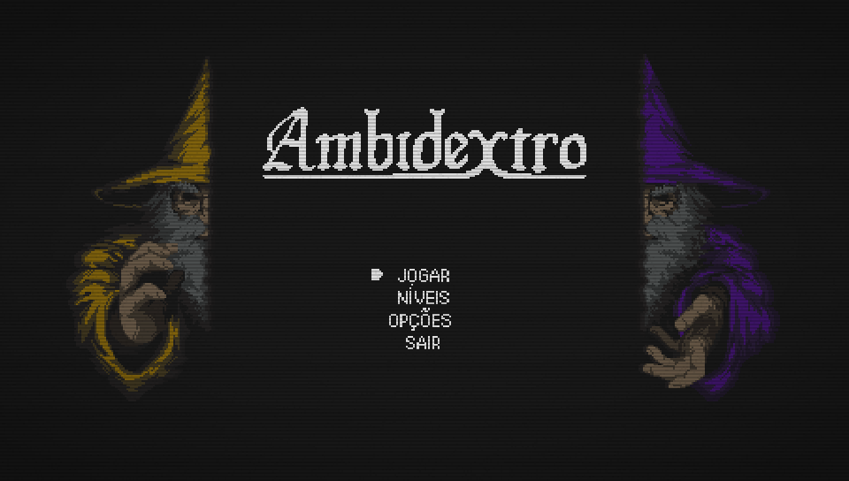
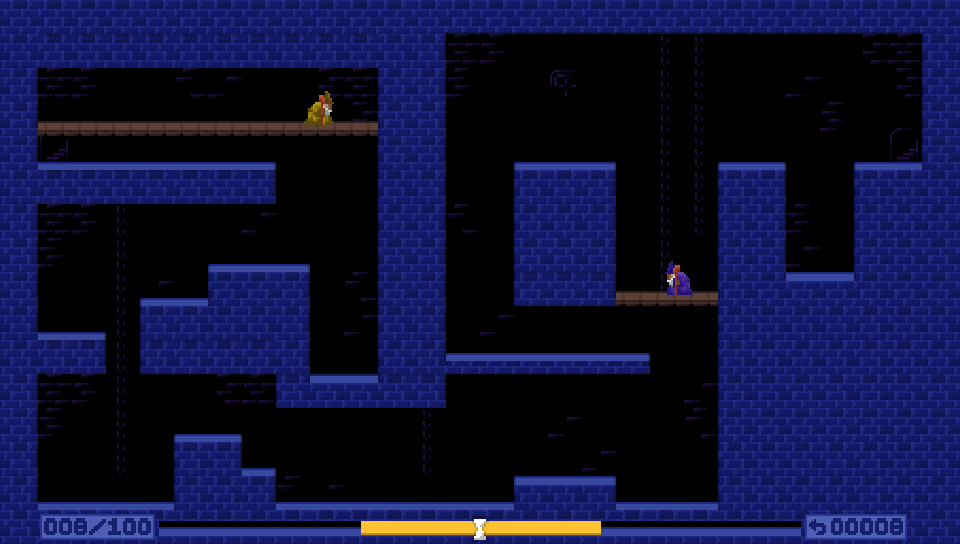
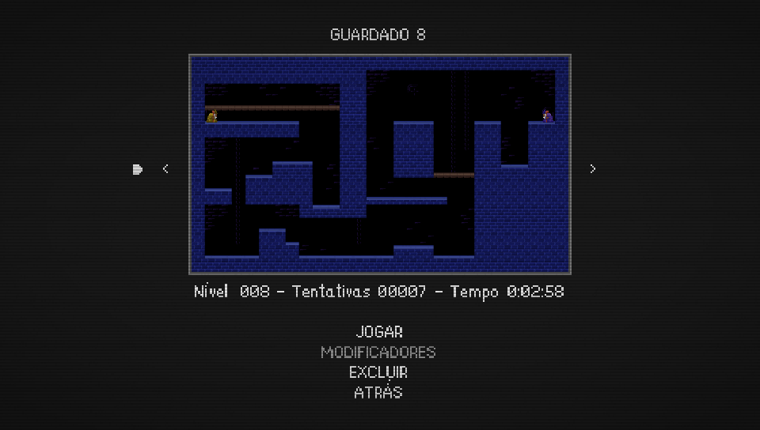
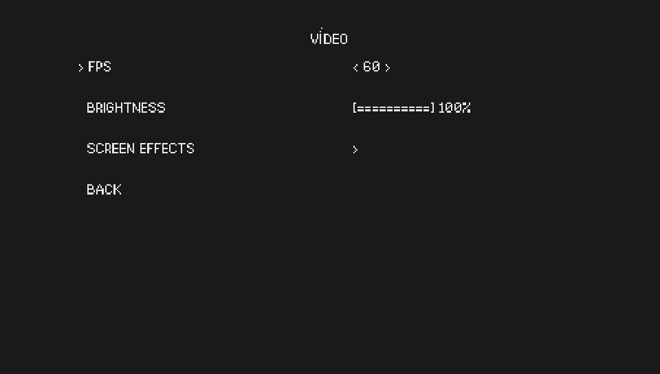
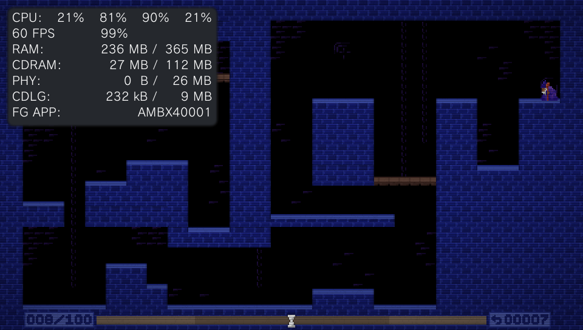
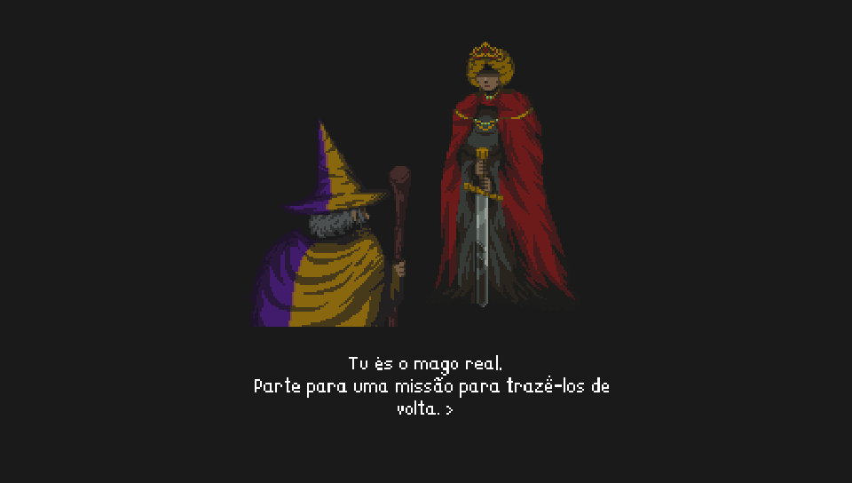

  <picture>
    <source media="(prefers-color-scheme: dark)" srcset="assets/brand/AmbidextroVita.png">
    <source media="(prefers-color-scheme: light)" srcset="assets/brand/Ambidextro-Vita-Black.png">
    
  </picture>

  An experimental, unofficial port of <a href="https://store.steampowered.com/app/3445580/Ambidextro/"><strong>Ambidextro</strong></a> for PlayStation Vita.

  <em>Powered by a customized <a href="https://github.com/WolffsRoom/godot4-vita">Godot 4 Vita</a> runtime, with native GXM 2D rendering.</em>

> [!IMPORTANT]
> **Work in progress!**
> **First experimental beta released.** Download the lite VPK and Windows patcher from [Releases](https://github.com/WolffsRoom/Ambidextro-Vita/releases). You must own the original Steam/PC game (supported version 1.2.5). No ready-made commercial game_data is distributed.

## Project status

  
  
   
  
  
  

 

The port currently boots and runs on real PS Vita hardware. Menu navigation, gameplay, audio and save/settings systems are under active testing. **Performance is not yet stable at 60 FPS**, and some effects in the opening cutscene still require GXM compatibility fixes.

| Component | Current state |
| :--- | :--- |
| Boot / LiveArea | Animated 960 × 544 startup and in-game boot working, return to LiveArea is being verified |
| Gameplay | Playable on physical hardware, further compatibility and performance testing in progress |
| Rendering | Native GXM 2D backend, remaining shader and <code>CanvasGroup</code> limitations |
| Audio | Music playback and transitions implemented, regression testing ongoing |
| Video settings | FPS cap (30 / 40 / 60 / Unlocked), software brightness and Screen Effects submenu |
| Performance | 60 FPS in some scenes, drops remain in heavier gameplay and during transitions |
| PC-to-Vita patcher | **v1.0 Windows patcher** — validated against PC/Steam 1.2.5 |
| Public VPK / Release | **First beta pre-release** — [Download](https://github.com/WolffsRoom/Ambidextro-Vita/releases) |

_If you enjoy my work, consider supporting the development!_

 <strong>Support this and other projects</strong></a>

## About the port

*Ambidextro* is a precision platformer by **Majorariatto** in which you control two halves of a wizard independently. This project explores running the original game's Godot content through a PlayStation Vita-specific runtime rather than recreating its gameplay in a different engine.

The Vita implementation uses a customized Godot 4.x runtime and direct GXM drawing for 2D graphics. Platform-specific work includes controller integration, memory management, texture handling, boot animation, audio adjustments, settings, and performance profiling.

This is an **unofficial fan project**, not affiliated with or endorsed by Majorariatto, Sony, or the Godot Engine project.

## Screenshots 

  

  
  

  
  

  
  

Captured during development on PS Vita. Screenshots may show debugging overlays, incomplete effects, or performance that differs from later builds.

## Installation and patcher

**The first experimental beta is available as a lightweight VPK and a separate Windows patcher.** A legally owned PC/Steam **Ambidextro 1.2.5** copy is required.

1. Download both files from [Releases](https://github.com/WolffsRoom/Ambidextro-Vita/releases).
2. Extract the Windows patcher ZIP and run **AmbidextroVitaPatcher.exe**. Keep its **GDRE** folder next to the EXE.
3. Point the patcher to your Steam installation or **Ambidextro.pck**. It rebuilds the Vita **game_data** and validates **3,052** output files by SHA-256.
4. Copy the generated **VitaFiles/ambidextrovita/** folder into **ux0:data/** using VitaShell.
5. Check that the result is **ux0:data/ambidextrovita/game_data/**, then install the lite VPK.

See the [full installation guide](docs/INSTALL.md) and [patcher documentation](Patcher/README.md).

**Do not download unrelated ready-made game_data packages.** This project does not distribute the original commercial game's files.

## Current development priorities

- Expand patcher support beyond the currently validated PC/Steam 1.2.5 input after testing.
- Improve FPS consistency and reduce stage-loading/restart stalls.
- Resolve remaining cutscene alpha, shader and CanvasGroup rendering differences.
- Verify the in-game **Exit → LiveArea** path and settings on real hardware.
- Complete stability and end-to-end gameplay testing before marking the first beta stable.

## Technical background

This port is built around [Godot 4 Vita](https://github.com/WolffsRoom/godot4-vita), [VitaSDK](https://vitasdk.org), a native [GXM](https://www.psdevwiki.com/vita/SceGxm) rendering path and Vita runtime integrations. It currently targets a Godot 4.8 development build adapted for the Vita.

Unlike the original PC renderer, the Vita renderer has specific limitations. Not every desktop shader or compositing effect is supported yet. Screenshots and performance results should be understood as work-in-progress.

## AI Notice

GPT-5.6 Sol through Codex was used as a development assistant for diagnostics, implementation support, project organization and technical documentation. 

## Credits

- [Majorariatto - Ambidextro](https://store.steampowered.com/app/3445580/Ambidextro/): original game, characters, artwork, sound, and design.
- [Godot Engine](https://godotengine.org): original engine.
- [WolffsRoom / Godot 4 Vita](https://github.com/WolffsRoom/godot4-vita): experimental Vita runtime and rendering backend.
- [VitaSDK](https://vitasdk.org) and the wider PS Vita homebrew development community.

---

<em>This repository is documentation-only during development.
The original game and all of its associated intellectual property remain the property of their respective rights holders.</em>

